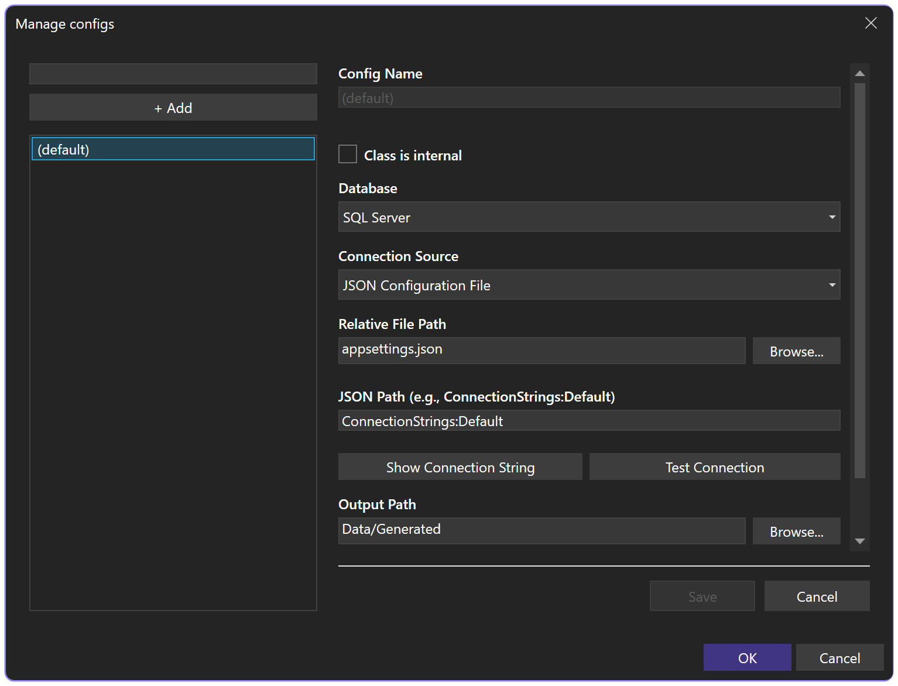
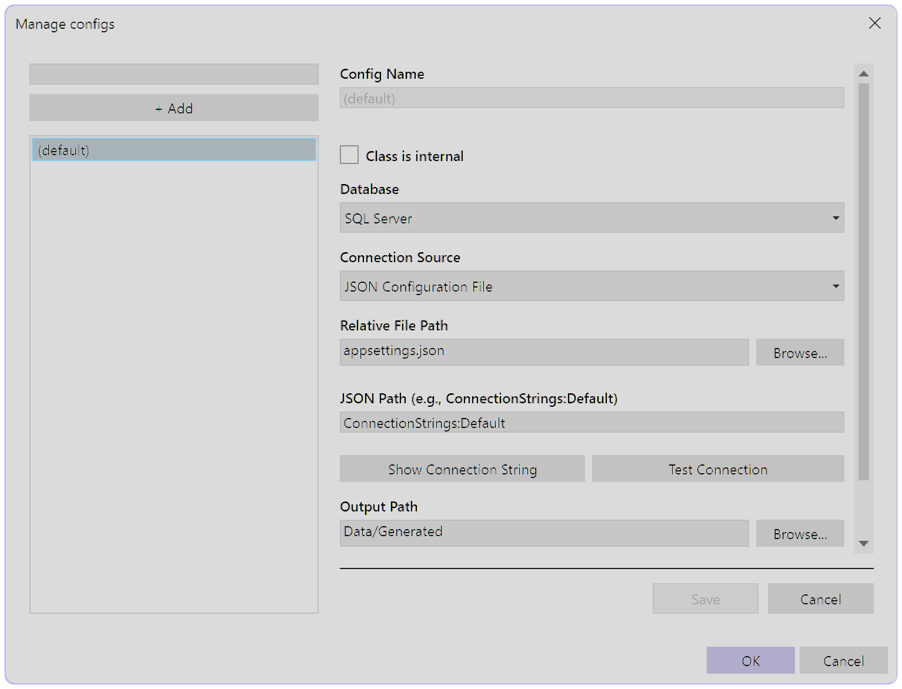

# Configure CodeGen

The configuration manager writes `rinkupt.json` in the project. The file supplies the database connection source and the output settings used by code generation.

A project can contain multiple configurations. The default produces `DbCommands.rinku.cs`; `rinkupt.<name>.json` or `rinku.<name>.json` produces `<name>.rinku.cs`. A constants-only `rinku.ENUM.json` can contain the connection settings and `ConstantsPath` without queries. Its output contains only the generated constants/enums, and all configurations refresh on build.

## JSON connection source

```json
{
  "JsonFile": "appsettings.json",
  "ConnectionExtractionPath": "ConnectionStrings:Default",
  "OutputPath": "Data/Generated",
  "Namespace": "MyApp.Data"
}
```

```json
{
  "ConnectionStrings": {
    "Default": "Server=.;Database=Music;Trusted_Connection=True;TrustServerCertificate=True"
  }
}
```

`ConnectionExtractionPath` walks JSON properties with `:` between names.

Open the project-level CodeGen configuration command to edit these settings:

<figure class="codegen-screenshot">


<figcaption>The configuration manager edits the connection source and generated-output settings represented by <code>rinkupt.json</code>.</figcaption>
</figure>

## Connection check

```text
Connection Source     JSON Configuration File
Relative File Path    appsettings.json
JSON Path              ConnectionStrings:Default
```

`Show Connection String` resolves the configured source. `Test Connection` opens the resolved connection through the selected or inferred provider.

## Database provider

The database selector supports automatic detection and explicit providers.

```json
{
  "Database": "Sqlite",
  "RawConnectionString": "Data Source=mydatabase"
}
```

Supported provider values are shown in the [configuration reference](configuration.md#database-provider).

## Output

```text
Output Path    Data/Generated
Namespace      MyApp.Data
Internal       false
```

The output path is project relative. Without an explicit namespace, CodeGen derives one from the project namespace and output path.

```json
{
  "OutputPath": "Data/Generated",
  "Namespace": "MyApp.Data",
  "IsInternal": true
}
```

`IsInternal` changes the generated command class accessibility.

## Constants and enums

In the connection form, **Constants / enums (optional)** selects None, SQL file, raw SQL or a parameterless stored procedure. For example:

```json
{
  "ConstantsPath": "Sql/Constants.sql"
}
```

The source returns one result set with five named string columns: `Name`, `Value`, `Type`, `Description`, `Parent`. Cast database numbers to strings. SQL NULL `Value` defines a container; an empty string remains a value. `Parent` is an absolute path such as `Application.Roles`, and missing containers are created automatically. Only containers can be roots, with SQL NULL `Parent`.

```sql
SELECT CAST(N'Reader' AS nvarchar(128)) AS Name,
       CAST(N'1' AS nvarchar(32)) AS Value,
       CAST(N'int' AS nvarchar(16)) AS Type,
       CAST(N'Read access' AS nvarchar(max)) AS Description,
       CAST(N'Application.Roles' AS nvarchar(128)) AS Parent;
```

This produces `Application.Roles.Reader` in the same generated file as the commands. Containers containing only compatible integers become enums, respecting the largest declared type; other containers become static classes with static readonly fields. Descriptions become `DescriptionAttribute`. Invalid names, duplicate paths, conflicting structure and invalid values fail refresh before replacing output. Removing `ConstantsSQL`, `ConstantsPath` or `ConstantsProc` removes those constants on the next refresh.

Supported scalar types are `sbyte`, `byte`, `short`, `ushort`, `int`, `uint`, `long`, `ulong`, `string`, `char`, `bool`, `float`, `double`, `decimal`, and their corresponding `System.*` names. Mixed signed/unsigned integers widen when needed. Negative values combined with values exceeding `long.MaxValue` produce fields, since no enum underlying type can hold both.

Visual Studio Refresh, CLI refresh and normal/manual build targets run the same generator. See [Refresh CodeGen](refresh.md). CLI `config init/set` also accepts one of `--constants-path`, `--constants-sql`, `--constants-proc`, `--constants-none`.

## Named configurations

```text
rinkupt.json
rinkupt.Reporting.json
rinkupt.Admin.json
```

Each file keeps its own connection source, queries, output path, and generated command file.

## Environment variable

```json
{
  "EnvironmentVariable": "MUSIC_DB"
}
```

## XML

```json
{
  "XmlFile": "App.config",
  "ConnectionExtractionPath": "//add[@name='Default']/@connectionString"
}
```

## Dot env

```json
{
  "DotEnvFile": ".env",
  "ConnectionExtractionPath": "MUSIC_DB"
}
```

## INI

```json
{
  "IniFile": "settings.ini",
  "ConnectionExtractionPath": "[Database]ConnectionString"
}
```

## MSBuild property

```json
{
  "MsBuildProject": "MyApp.csproj",
  "ConnectionExtractionPath": "CodeGenConnectionString"
}
```

## User secrets

```json
{
  "NetUserSecrets": "MyApp.csproj",
  "ConnectionExtractionPath": "ConnectionStrings:Default"
}
```

The project file supplies the `UserSecretsId` used by this source.

## Launch settings

```json
{
  "LaunchSettings": "Properties/launchSettings.json",
  "ConnectionExtractionPath": "Development:MUSIC_DB"
}
```

The first path segment selects the launch profile. The second selects its environment variable.

[Configuration file](configuration.md) · [Add queries](queries.md)
