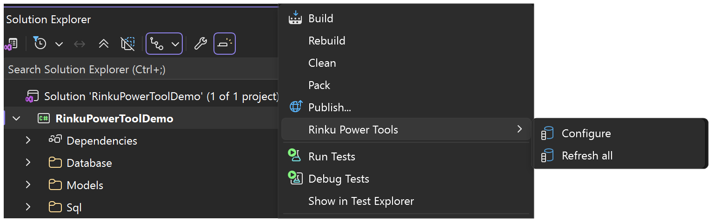
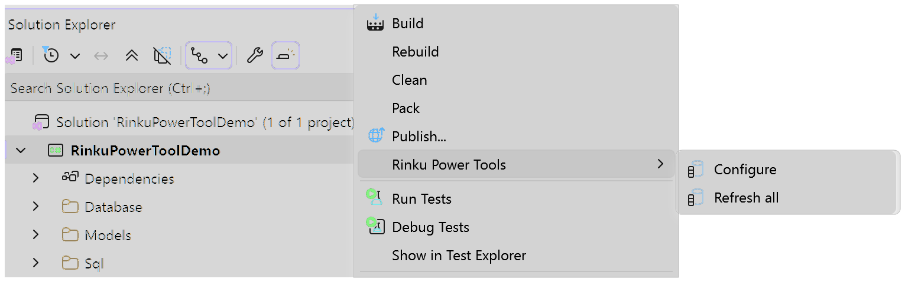

# Code generation

Rinku Power Tools is the optional companion tooling for the `Rinku` library. It reads project CodeGen settings and SQL definitions, then generates ordinary C# command methods and typed result metadata for the Rinku runtime.

## What it produces

This SQL query is transformed into a typed command and result shape:

```sql
SELECT AlbumId AS Id, Title FROM albums WHERE ArtistId = @artistId
```

CodeGen produces a typed result and a `DbCommand` method:

```csharp
public partial record GetAlbumsByArtistResult(int Id, string Title);

public static partial class DbCommands
{
    public static DbCommand GetAlbumsByArtist(this DbConnection connection, int artistId)
    {
        DbCommand command = connection.CreateCommand();
        command.CommandText = @"SELECT AlbumId AS Id, Title FROM albums WHERE ArtistId = @artistId";
        command.CommandType = CommandType.Text;
        command.Add("@artistId", DbType.Int32, artistId);
        return command;
    }
}
```

The generated command can be parsed through Rinku:

```csharp
static readonly CachedTypeParser<List<GetAlbumsByArtistResult>> Parser = new();

List<GetAlbumsByArtistResult> albums = Parser.Query(cnn.GetAlbumsByArtist(artistId: 7));
```

## How to produce it

The project stores the query definition in its `rinkupt` configuration:

```json
{
  "MethodName": "GetAlbumsByArtist",
  "SQLQuery": "SELECT AlbumId AS Id, Title FROM albums WHERE ArtistId = @artistId"
}
```

Configure the project, add the query, and refresh the generated code from [Configure CodeGen](configure.md), [Add queries](queries.md), and [Refresh generated code](refresh.md).

In Visual Studio, the project-level commands are opened by right-clicking the project in Solution Explorer:

<figure class="codegen-screenshot">


<figcaption>Project-level commands are opened from the selected project.</figcaption>
</figure>

[Configure](configure.md) · [Add queries](queries.md) · [Generated commands](generated-code.md) · [Refresh and CLI](refresh.md)

## SQL file command

```json
{
  "MethodName": "GetAlbums",
  "SQLFile": "Sql/GetAlbums.sql"
}
```

```csharp
using DbCommand command = cnn.GetAlbums();
```

The generated command reads the current SQL through `RinkuPowerTools.GetSqlFile`.

[SQL file generation and runtime replacement](generated-code.md#sql-files)

## Schema metadata

```csharp
using Rinku.Mapping;

[Schema("2026-08-21T14:00Z")]
public partial record GetAlbumResult(int Id, string Title);

[BasedOn(typeof(GetAlbumResult), "2026-08-21T14:00Z")]
public record AlbumDto(int Id, string Title);
```

`Schema` records only the source version for analyzers. `BasedOn` selects the runtime member and can
also acknowledge the source version. The analyzers ship in the `Rinku` package. Power Tools is not
required for them.

Generated result records use the independent support types emitted in `.PowerTools.rinku.cs`:

```csharp
[Schema("2026-08-21T14:00Z")]
public partial record GetAlbumsByArtistResult(int Id, string Title);
```

Power Tools writes `.PowerTools.rinku.cs` at the project root. This support file contains the generated
`RinkuPowerTools` ADO.NET helpers and `TrueNameAttribute`.

Generated result records use `RinkuPowerTools.Generated.SchemaAttribute` from that support file,
so the generated commands and result records compile without a Rinku reference. Application-owned
schema links use the existing `Rinku.Mapping.BasedOnAttribute`; PowerTools does not generate a duplicate.
The command file records the last reload time. The shared helper is rewritten only when its content changes.

[Analyzers and code fixes](analyzers.md)
