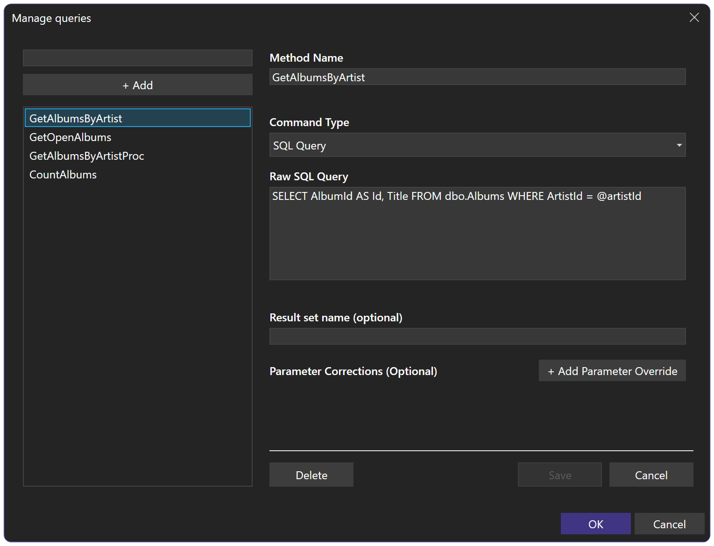
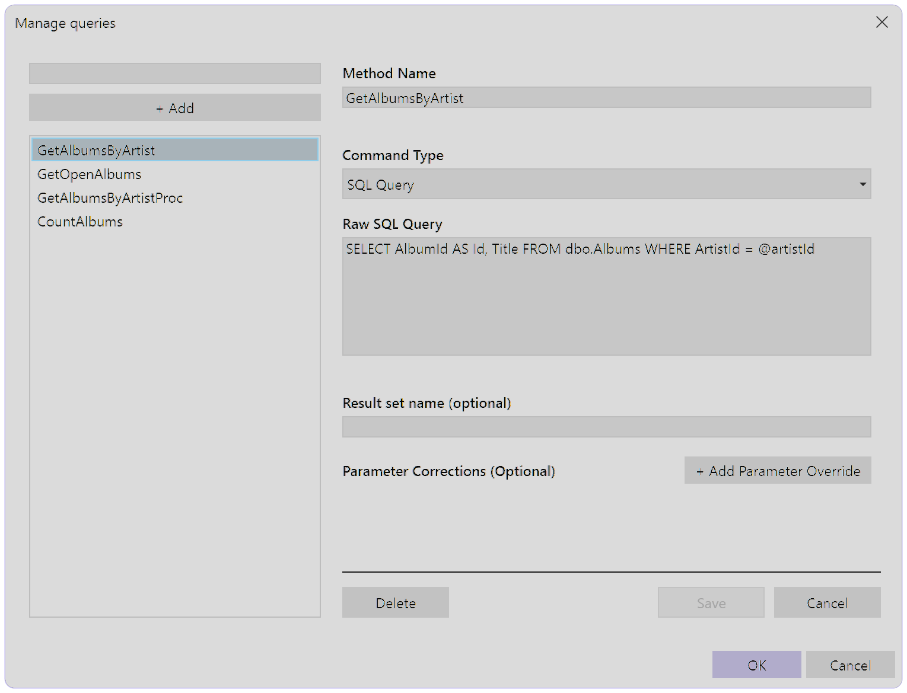
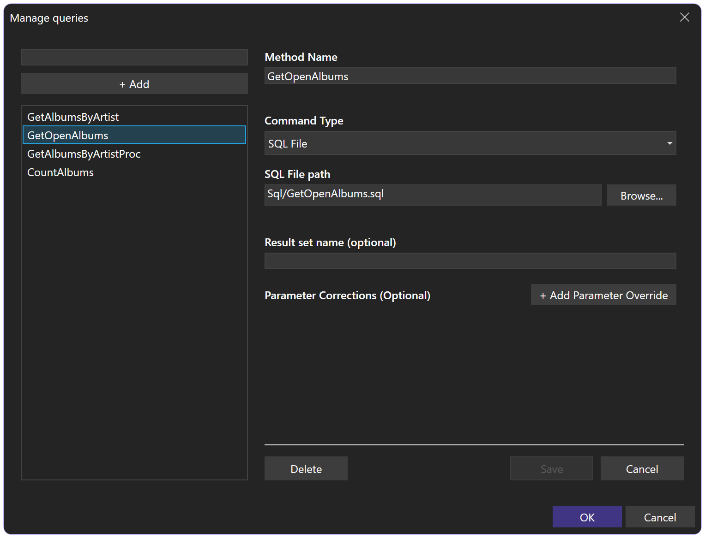
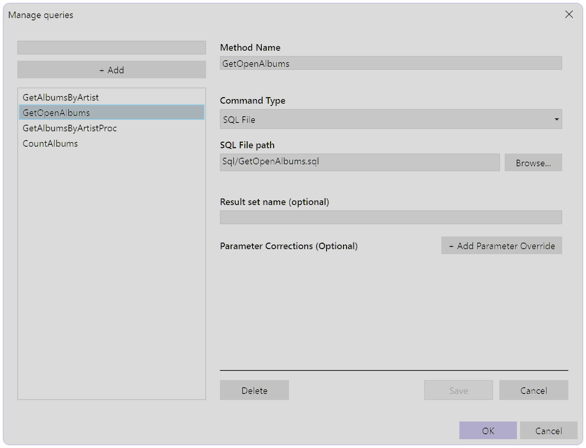

# Add queries

Each query entry produces one generated command method.

For example, this entry produces a command that can be passed directly to Rinku parsing:

```csharp
static readonly CachedTypeParser<List<GetAlbumsByArtistResult>> Parser = new();

using DbCommand command = cnn.GetAlbumsByArtist(artistId: 7);
List<GetAlbumsByArtistResult> albums = Parser.Query(command);
```

<figure class="codegen-screenshot">


<figcaption>The query manager defines the command and its result metadata.</figcaption>
</figure>

## SQL text

```text
Method Name    GetAlbumsByArtist
Command Type   SQL Query
```

```sql
SELECT AlbumId AS Id, Title FROM albums WHERE ArtistId = @artistId
```

```json
{
  "MethodName": "GetAlbumsByArtist",
  "SQLQuery": "SELECT AlbumId AS Id, Title FROM albums WHERE ArtistId = @artistId"
}
```

CodeGen inspects the command against the configured database to discover inputs and returned columns.

## Stored procedure

```text
Method Name             ArchiveInvoices
Command Type            Stored procedure
Stored Procedure Name   dbo.ArchiveInvoices
```

```json
{
  "MethodName": "ArchiveInvoices",
  "StoredProcName": "dbo.ArchiveInvoices"
}
```

SQL Server and PostgreSQL expose stored procedure entries through the configured database connection.

## SQL file

Select <code>SQL File</code> and provide the project-relative SQL path:

<figure class="codegen-screenshot">


<figcaption>A query can use a checked-in SQL file instead of inline SQL text.</figcaption>
</figure>

```text
Method Name    GetOpenInvoices
Command Type   SQL File
SQL File       Sql/GetOpenInvoices.sql
```

```json
{
  "MethodName": "GetOpenInvoices",
  "SQLFile": "Sql/GetOpenInvoices.sql"
}
```

A file inside the project is stored as a project relative path. A file outside the project is stored as an absolute path.

```text
C:\Projects\MyApp\Sql\GetOpenInvoices.sql
    -> Sql/GetOpenInvoices.sql

D:\SharedSql\GetOpenInvoices.sql
    -> D:\SharedSql\GetOpenInvoices.sql
```

A relative file is copied to build and publish output at the same relative path. An absolute file stays absolute and is not copied.

The generated command keeps the configured file reference.

[SQL files at runtime](generated-code.md#sql-files)

## Result name

```csharp
public partial record GetAlbumsByArtistResult(int Id, string Title);
```

A configured result set name changes that generated type name.

```text
Method Name       GetAlbumsByArtist
Result Set Name   AlbumRow
```

```csharp
public partial record AlbumRow(int Id, string Title);
```

## Parameter correction

```text
Name          @cutoff
Type          datetime2
Is Nullable   false
```

```json
{
  "MethodName": "ArchiveInvoices",
  "StoredProcName": "dbo.ArchiveInvoices",
  "Parameters": [
    {
      "Name": "@cutoff",
      "Type": "datetime2",
      "IsNullable": false
    }
  ]
}
```

A correction updates metadata for the named discovered parameter.

### Optional C# arguments

A correction can supply only a default, leaving discovered type and nullability unchanged:

```json
{
  "Name": "@Id",
  "DefaultValue": "null"
}
```

For a discovered nullable integer, this generates `int? Id = null`. `DefaultValue` is a C# expression string: examples include `"10"`, `"false"`, `"default"` and `"\"text\""`. Omit the property to keep the argument required. A JSON null also means no configured default; the string `"null"` supplies an optional null default. Configure exposes the same expression in its Default column.

Defaults apply to input-only parameters and must form a trailing group in the discovered argument order. Generation fails for a required argument following an optional one, a default on an output/input-output parameter, or malformed expression syntax. Arguments are never reordered.

The C# compiler checks whether the expression is a legal default for the discovered type. Configured defaults affect the generated C# factory arguments. They do not change database defaults or SQL text.

## PostgreSQL positional parameters

```sql
SELECT title FROM album WHERE artist_id = $1
```

The generated C# argument uses a valid name such as `p1`. The parameter is added in positional order.

[Generated PostgreSQL command](generated-code.md#postgresql-parameters)

## SQLite untyped parameter

```json
{
  "Name": "$id",
  "Type": "integer",
  "IsNullable": false
}
```

Without a correction, an unresolved SQLite query parameter stays `object?` and the provider infers its runtime type.

[Generated SQLite command](generated-code.md#sqlite-parameters)


## Remove a query

```text
Delete query
Refresh configuration
Generated method is removed
```

[Refresh generated code](refresh.md)

## Before/after hooks

Select **Generate before/after hooks** on a query to generate optional partial methods around command construction:

```json
{
  "MethodName": "Refresh",
  "SQLFile": "Sql/Refresh.sql",
  "GenerateHooks": true
}
```

The command class is partial. Implement either hook in another source file in the same namespace and assembly. For a factory with an `int Id` argument, the three hooks are:

```csharp
using System;
using System.Data.Common;

namespace MyApp;

public static partial class DbCommands
{
    static partial void BeforeRefresh(DbConnection connection);
    static partial void BeforeRefresh(DbConnection connection, ref int Id);
    static partial void AfterRefresh(DbCommand command);

    static partial void BeforeRefresh(DbConnection connection)
    {
        ArgumentNullException.ThrowIfNull(connection);
    }

    static partial void BeforeRefresh(DbConnection connection, ref int Id)
    {
        Id = Math.Max(Id, 0);
    }

    static partial void AfterRefresh(DbCommand command)
    {
        command.CommandTimeout = 60;
    }
}
```

`BeforeRefresh(DbConnection)` runs first, followed by `BeforeRefresh(DbConnection, ref ...)` when the factory has input values. Both run before command creation and receive the connection by value. Only input values are passed by `ref`, using their discovered C# types.

This includes the input value of an input/output SQL parameter, but excludes SQL output handles. Changes to input values are used when binding SQL parameters. Hook declarations omit optional argument defaults. A factory with no input values generates and calls only the connection-only before hook.

`AfterRefresh` receives the completed command, with its text, command type and parameters already set. It runs before the factory returns, not after SQL execution. It is a direct call without generated exception handling. If its implementation throws, that implementation is responsible for disposing the command.

Factories with the same name share the connection-only before hook and after hook. Parameterized before hooks are shared when their C# signatures match; distinct input types produce overloads. Each declaration is emitted once.

Unimplemented partial hooks and their calls are removed by the C# compiler. Disabled queries generate neither hook declarations nor calls, and JSON omits the false flag. There is no shared callback or reflected method field. The CLI exposes the same flag through `query add` and `query set` with `--generate-hooks true` or `--generate-hooks false`.
