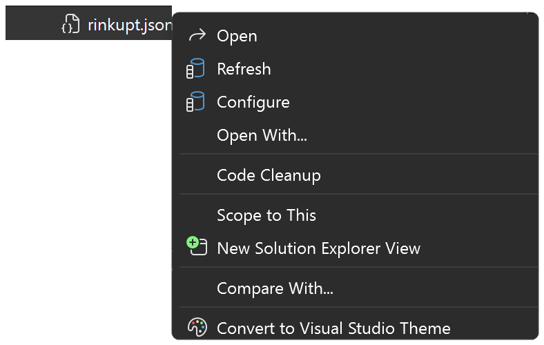
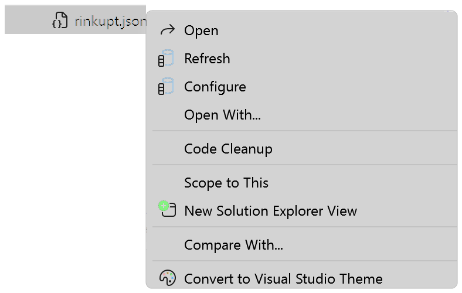
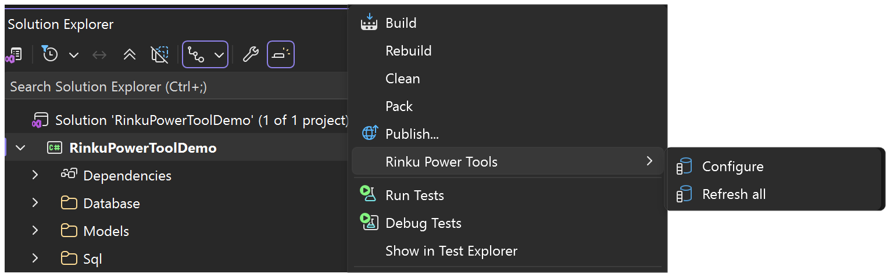
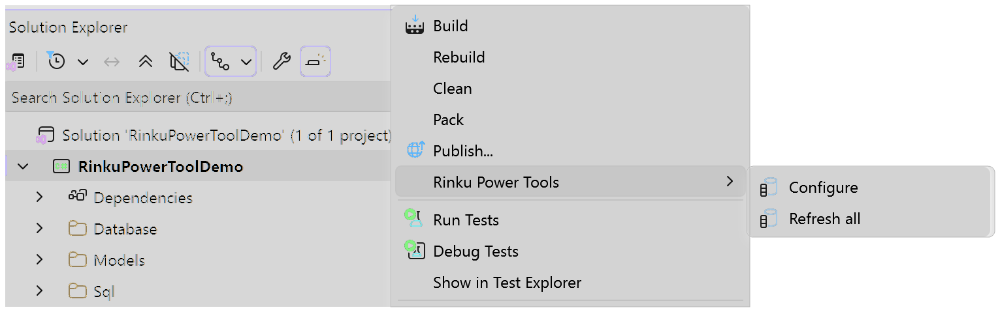

# Refresh generated code

Refreshing turns the current configuration and SQL definitions into the generated command and result files used by the application.

## One configuration

Right-click a `rinkupt.json` file to refresh one configuration:

<figure class="codegen-screenshot">


<figcaption>The file context menu provides <code>Refresh</code> and <code>Configure</code> for the selected configuration.</figcaption>
</figure>

```text
rinkupt.json
    Rinku Power Tools
        Refresh
```

Refreshing the selected configuration regenerates its command file and opens the generated file.

## Configure and regenerate

```text
rinkupt.json
    Rinku Power Tools
        Configure
```

The configuration manager saves the selected file and regenerates it when the changes require generation.

## All project configurations

Right-click the project in Solution Explorer to refresh every project configuration:

<figure class="codegen-screenshot">


<figcaption>The project context menu exposes <code>Refresh all</code> for every <code>rinkupt</code> configuration.</figcaption>
</figure>

```text
Project
    Rinku Power Tools
        Refresh all
```

Each `rinkupt` configuration is loaded and generated separately.

## Command-line refresh

The CLI uses the same shared generation implementation as the Visual Studio extension:

```text
rinku refresh
rinku refresh dev
rinku refresh --default
```

`rinku refresh` refreshes every valid `rinkupt*.json` configuration beside the selected project. It succeeds without doing anything when no configuration exists. `rinku refresh dev` selects `rinkupt.dev.json`, while `rinku refresh --default` selects `rinkupt.json`; an explicitly selected missing configuration is an error.

The packaged build target runs `rinku refresh` before compilation, including all configurations. It skips design-time builds and can be disabled for one build with `-p:RinkuPowerToolsRefreshOnBuild=false`.

### Install the CLI and build integration

Install the CLI when you want to run refresh and configuration commands directly:

```bash
dotnet tool install --global RinkuPowerTools.Cli
```

```text
rinku help
```

To run refresh automatically before compilation, add the companion build package to the application project. It contains the CLI runtime and MSBuild target, so a separate tool installation is not required for builds. Keep it private because it contributes build tooling rather than an application dependency:

```text
<PackageReference Include="RinkuPowerTools.Cli.Build" Version="0.1.0-alpha" PrivateAssets="all" />
```

`RinkuPowerTools.Cli` and `RinkuPowerTools.Cli.Build` share an independent Power Tools version and are released together. They are not tied to the core `Rinku` version; use matching versions of the two Power Tools packages when pinning them. Install `Rinku` separately when the generated application code uses the Rinku runtime.

## Query generation failure

```csharp
#error Query generation failed for method 'GetBrokenAlbums'

// Other valid generated methods can still be emitted below this failure.
```

One failing query does not stop the other query entries from being generated.

## Result record after refresh

```csharp
public partial record GetAlbumsResult(int Id, string Title);

public partial record GetAlbumsResult
{
    public string Display => Title;
}
```

When the discovered result shape is unchanged, the generated record text is retained. When the shape changes, CodeGen regenerates that record from the discovered columns. Application members remain in the separate partial declaration.

[Generated commands](generated-code.md)
